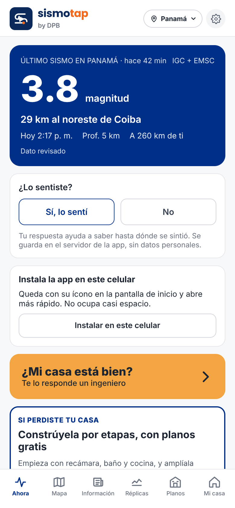
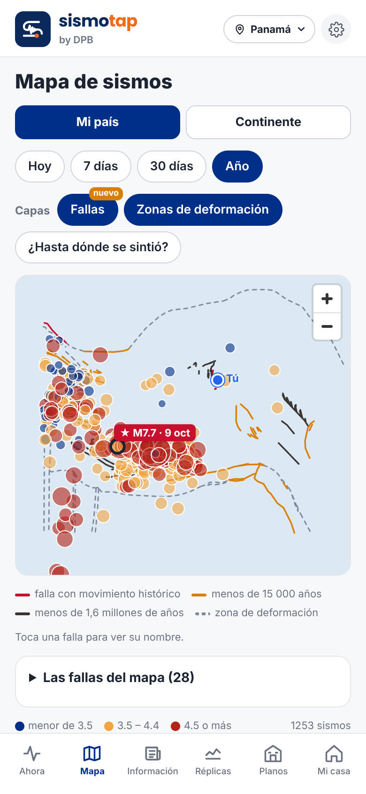
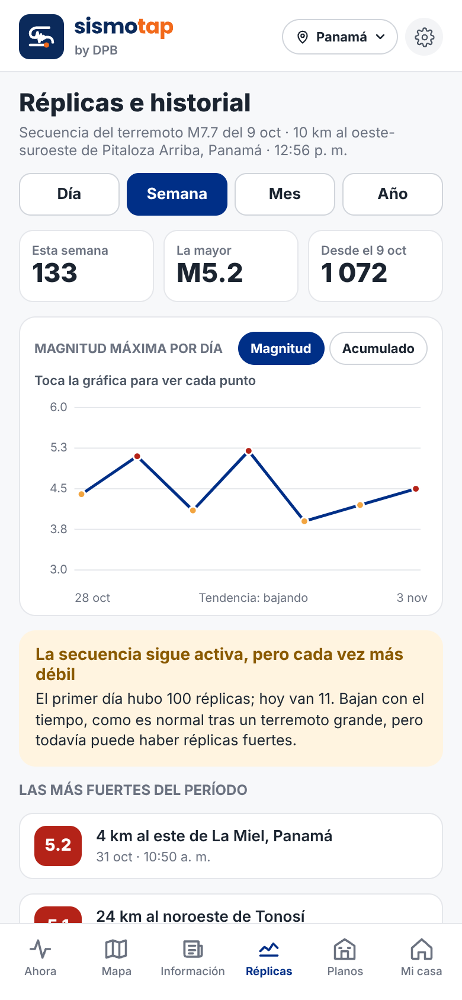
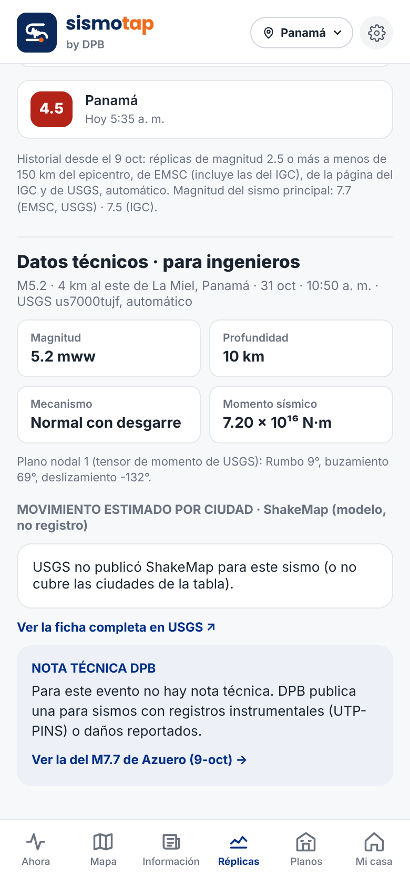
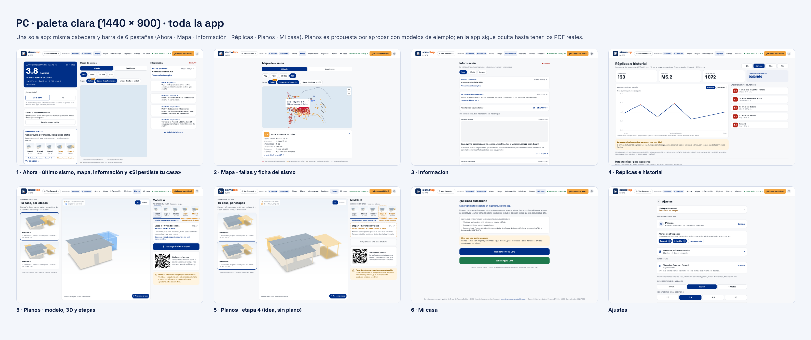
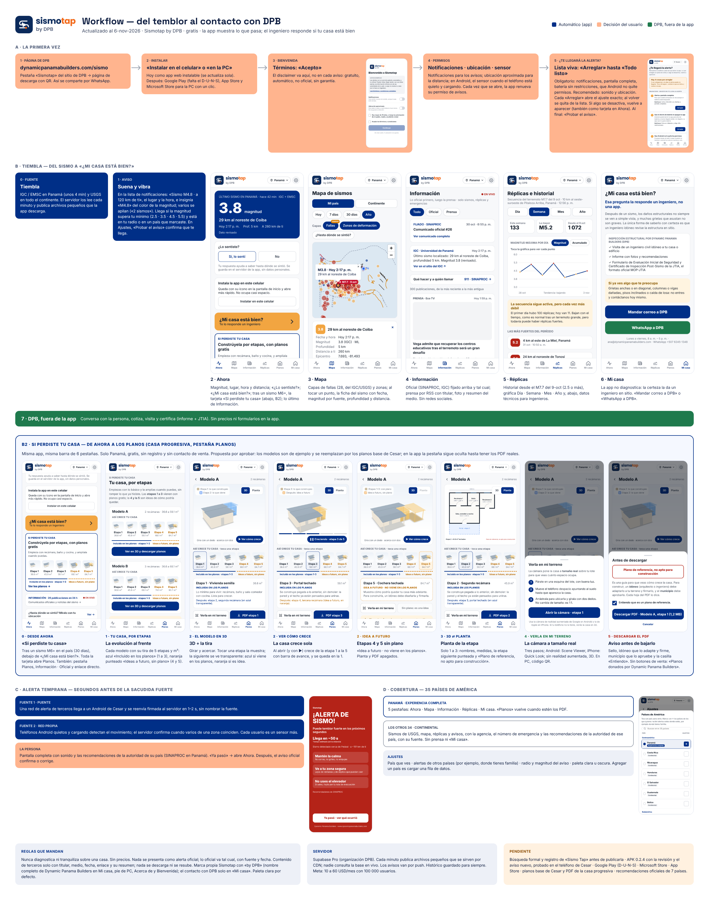

# Cesar R. Fong Urbina — Software Portfolio

Civil engineer and founder of [Dynamic Panama Builders](https://dynamicpanamabuilders.com) (Panama, since 2012). Since 2026 I build software by directing AI coding agents: I own the product, the architecture, the specifications and the acceptance criteria; AI agents (Claude Code) write the code under automated tests and review gates.

This repository is a **showcase**. It describes what each product does, how it is built and what I learned. The source code of these products is private; access for a technical review can be arranged on request.

[LinkedIn](https://www.linkedin.com/in/cesar-r-fong-urbina-723a3051/) · cesarfong@dynamicpanamabuilders.com

---

## 1. Yunque — autonomous software factory

**What it is.** An orchestration platform that turns a written specification into working software with minimal human intervention. I describe a product; Yunque breaks it into work items, runs AI coding agents on them, verifies each result and keeps the project aligned with the original scope.

**How it works**

- **Job queue and runner.** Work items live in a PostgreSQL backlog (Supabase). A local runner picks them up and launches AI coding agents, running jobs from different projects in parallel lanes.
- **Verification gates.** No job closes on the agent's word. Each item carries verifiable acceptance criteria; automated tests and a separate auditor agent check the result, and a failing job is sent back with the evidence. Built to eliminate "false greens".
- **Scope auditor.** At the end of a project an auditor compares what was built against the original scope, so requirements cannot silently disappear along the way.
- **Production method.** A fixed, Scrum-based process: brief → research with recorded sources → specification with testable criteria → sprint (build + automated QA, max. 3 rounds) → retrospective that updates the process.
- **Remote control.** An MCP server deployed 24/7 on Railway exposes the factory to AI assistants, so work can be queued, monitored and approved from a phone. Mutating actions require a shared token; irreversible actions wait in an approval tray.

**Stack:** Supabase (PostgreSQL, SQL functions, migrations) · Python/Node runner on Windows · Claude Code (subagents, structured JSON output, hooks) · MCP server on Railway · Git branch-per-job workflow

**What I learned:** automating the hand-off between AI tools is easy; keeping the *judgment* in the loop (reading real results, re-planning, guarding scope) is the hard part, and it has to live in code, not in prompts.

---

## 2. ORYM — life-organizer mobile app (v1)

**What it is.** A personal organizer for tasks, calendar, budget and life records, with one differentiator: **AI Mode**. Through an MCP server, users connect their own AI assistant (Claude, ChatGPT) and manage the app by conversation, while a full **Manual Mode** keeps the app usable without AI.

**Highlights**

- Mobile app built with React Native + Expo (SDK 54); Android build produced and tested on device.
- Supabase backend with row-level security; multi-user MCP server deployed 24/7 on Railway with a validated read/write cycle.
- Google Calendar integration, statistics tab, swipe navigation, account deletion.
- Six languages (EN, ES, DE, IT, FR, PT).
- CI on GitHub Actions (unit, end-to-end and visual tests, release pipeline).

**Stack:** React Native · Expo · TypeScript · Supabase · Railway · MCP · GitHub Actions · EAS Build

---

## 3. Sismotap — earthquake information app for Panama and the Americas

**Live web app:** [app.dynamicpanamabuilders.com](https://app.dynamicpanamabuilders.com) · Android build in testing, Google Play release in progress

**What it is.** A free public app, launched after the M7.7 earthquake that hit Panama in October 2026, that puts official seismic data, aftershock history and news in one place. It never diagnoses a building: its only call to action is "Is my house OK?", which connects people with a licensed structural engineer.

| Now | Map | Aftershocks | Technical data |
|---|---|---|---|
|  |  |  |  |

**Highlights**

- Official sources merged and labelled: Panama's national seismic network, USGS and EMSC, with coverage across 35 countries of the Americas.
- Map with faults and per-quake detail, aftershock statistics and trend, crowd-sourced "Did you feel it?" reports stored without personal data.
- "Rebuild in stages": free reference house plans with an in-browser 3D viewer and augmented-reality "see it on my lot" (model-viewer, glTF).
- Phone and desktop layouts, light and dark themes; installable as a PWA and packaged for Android.
- Built spec-first: a written "button contract" of 77 acceptance criteria, each backed by an automated end-to-end test (114 tests passing).

Full user workflow

---

## How I work

| Role | Who |
|---|---|
| Product owner — what to build and in what order | Me |
| Scrum master / tech lead — specifications, review, process | AI assistant (Claude) under my direction |
| Developers | AI coding agents (Claude Code) |
| QA | Automated tests + independent auditor agent |

I am a civil engineer, not a trained programmer. My edge is turning ambiguous requirements into precise, verifiable specifications, the same skill I have used for 20+ years to deliver buildings, dams and infrastructure.
